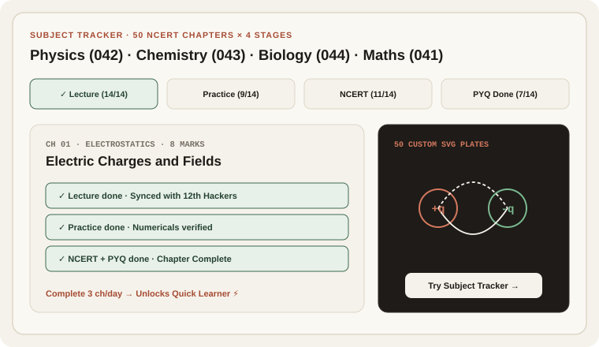

# Quadra 12 (v3.1)

[](https://github.com/Ariyanpal1008/Quadra12/releases/tag/v3.1)
[-A64B33.svg?style=flat-square)](#installable-offline-pwa--signed-android-apk-0)
[](#3-examination-hall--deterministic-omr-audit-settings--archive)
[](#tech-stack)

> **Quadra 12 v3.1 Release:** Synchronizes the **Overview Board Exam Countdown** with the **Official CBSE 2027 Date Sheet** (automatic IST progression, live `"X Days Left"` / `"Exam Today"` / `"✓ Completed"` states, and automatic post-board expiry after 9 April 2027), adds **Forced Landscape Full-Screen playback** inside **12th Hackers** (even when mobile Auto-Rotate is turned off), and unifies the entire workspace on `v3.1` alongside **4 PCMB Study Libraries (50 NCERT chapters)**, **720 Verified Questions**, **Deterministic OMR Examination Hall**, **Local A4 PDFs**, **Multi-Student Profiles**, **Offline PWA (`quadra12-v3.1`)**, and **Signed Android `.apk` (`Quadra12-v3.1-Android.apk`)**.

- **Current Version:** `v3.1`
- **Live Web & PWA App:** [https://ariyanpal1008.github.io/Quadra12/](https://ariyanpal1008.github.io/Quadra12/) *(Installable offline on Android, iOS/iPadOS, Windows & macOS)*
- **Free Signed Android `.apk` Download:** [GitHub Releases (`Quadra12-v3.1-Android.apk`)](https://github.com/Ariyanpal1008/Quadra12/releases/tag/v3.1) *(100% Free — `$0`)*
- **GitHub Repository:** [https://github.com/Ariyanpal1008/Quadra12](https://github.com/Ariyanpal1008/Quadra12)
- **Release Notes:** [`RELEASE_NOTES_v3.1.md`](RELEASE_NOTES_v3.1.md) *(Historical v2.6.2 notes: [`RELEASE_NOTES_v2.6.2.md`](RELEASE_NOTES_v2.6.2.md))*
- **Creator:** AriYan Pal (Keśava Dāsa) · `ariyanpal090@gmail.com`
- **Copyright:** © 2026 Quadra 12 · Creator: AriYan Pal (Keśava Dāsa)

---

## Official CBSE Class 12 Board Exam 2027 Date Sheet (Synced on Overview)

The **Overview** countdown clock (`BoardCountdownClock.tsx` backed by `src/data/cbseDateSheet2027.ts`) ticks live in **IST (`UTC+05:30`)**, automatically advances to the next subject once each exam ends, displays a dedicated **`View 2027 Date Sheet`** modal with live `"X Days Left"`, `"Exam Today"`, and green `"✓ Completed"` (dimmed + strikethrough) badges, and hides cleanly (`display: none`) after **9 April 2027 at 01:30 PM IST**. *(Examination Hall remains strictly dedicated to internal Quadra 12 practice exams.)*

| # | Subject | Subject Code | Official Exam Date | IST Timing |
| :---: | :--- | :---: | :--- | :--- |
| 1 | **Physics** | `042` | Tuesday, 16 February 2027 | `10:30 AM – 01:30 PM IST` |
| 2 | **Physical Education** | `048` | Thursday, 18 February 2027 | `10:30 AM – 01:30 PM IST` |
| 3 | **Fine Arts** *(Painting, Graphics, Sculpture, Applied Art)* | `049 / 050 / 051 / 052` | Wednesday, 24 February 2027 | `10:30 AM – 12:30 PM IST` |
| 4 | **Chemistry** | `043` | Saturday, 27 February 2027 | `10:30 AM – 01:30 PM IST` |
| 5 | **Mathematics / Applied Mathematics** | `041 / 241` | Tuesday, 9 March 2027 | `10:30 AM – 01:30 PM IST` |
| 6 | **Biology** | `044` | Thursday, 25 March 2027 | `10:30 AM – 01:30 PM IST` |
| 7 | **Computer Science** | `083` | Wednesday, 31 March 2027 | `10:30 AM – 01:30 PM IST` |
| 8 | **Web Application** | `803` | Friday, 9 April 2027 | `10:30 AM – 01:30 PM IST` |

---

## Visual Showcase

| Overview: CBSE 2027 Date Sheet Clock & Achievements | Subject Tracker: 50 Chapters & Study Libraries |
| :---: | :---: |
| [](https://ariyanpal1008.github.io/Quadra12/) | [](https://ariyanpal1008.github.io/Quadra12/) |
| **CBSE 2027 IST Chronometer** (auto-advancing 8-exam Date Sheet + auto-expiry) & **My Achievements**. | **50 NCERT Chapters × 4 Checkpoints + Study Libraries** + explicit `ChapterStudyStatus`. |

| Examination Hall: OMR, Practice Mode & PDFs | 12th Hackers & Landscape Full-Screen Player |
| :---: | :---: |
| [](https://ariyanpal1008.github.io/Quadra12/) | [](https://ariyanpal1008.github.io/Quadra12/) |
| **8 Published Single-Choice OMR Papers**, **720 Verified Practice Qs**, **Unconditional 0-Mark Result Review**, & **Local A4 PDFs**. | **50 One-Shot Lectures** synced to `Lecture done`, `fs=0` + **Forced Landscape Full-Screen**, & Interactive Tour. |

---

## What's New in Quadra 12 v3.1

### 1. Synced CBSE 2027 Date Sheet Countdown, Split-Flap Tiles & Auto-Expiry (Overview)
- Real-time IST (`UTC+05:30`) countdown synced to all 8 CBSE Class 12 Board Exam dates above (`src/data/cbseDateSheet2027.ts` + `src/components/BoardCountdownClock.tsx`), animated with 3D mechanical split-flap paper-turning tiles (`RollingClockTile` with whisper-thin center crease and cast shadows).
- **`View 2027 Date Sheet`** modal connected directly to the Overview countdown card showing live **`X Days Left`** badges, **`Exam Today`** row highlights, green **`✓ Completed`** badges with subtle dimming/strikethrough after exam end time, automatic rollover to the next subject, and automatic `display: none` removal once Web Application ends on **9 April 2027 at 01:30 PM IST**.

### 2. Forced Landscape Full-Screen in 12th Hackers Video Player
- Every YouTube embed inside **12th Hackers** (`src/components/YouTubeSyncPlayer.tsx` & `src/components/HackersPlaylistSection.tsx`) automatically appends `fs=0` to disable YouTube's built-in fullscreen button.
- A themed Quadra 12 **`Full Screen`** button (`#231f1e` background, `#f8f5f0` text, rounded corners) sits at the bottom-right corner of the `position: relative` video container and hides automatically once full-screen is active, revealing a crisp top-right **`Exit`** control.
- Tapping **`Full Screen`** requests container fullscreen (`requestFullscreen()` / `webkitRequestFullscreen()` or CSS full-viewport fallback), calls `await screen.orientation.lock('landscape')` inside `try...catch`, and automatically applies an edge-to-edge **90° CSS landscape rotation** whenever the device stays in portrait (such as mobile Auto-Rotate OFF or preview iframes), restoring portrait cleanly via `screen.orientation.unlock()` on exit.
- Playlist switching, unit chapter formula overlays, chapter timestamps, and automatic `Lecture done` completion tracking remain intact.

### 3. Examination Hall — Deterministic OMR, Audit Settings & Archive
- **8 Published Single-Choice OMR Papers (`src/data/verifiedPapers.ts`):** Each PCMB subject features **Full-Syllabus Competitive Mock Paper I (`+4/−1`)** and **CBSE Board Sprint Paper II (`+1/0`)** with full deterministic `VerifiedMarkingScheme`s, clean `Quadra 12` branding, and subject cards displaying `Best` scores once attempted.
- **Human-Approved Publication Gatekeeper (`canPublishExamPaper`):** Live OMR exams admit papers only when `status` is `'Approved'` or `'Published'` AND a matching `'Approved'`/`'Published'` `VerifiedMarkingScheme` covers every question. **Verified Paper Audit & Marking-Scheme Standards** (`AuthorReviewPanel.tsx`) lives inside **Settings → Exam & Paper Audit**.
- **Live Key Stripping & Unconditional 0-Mark Result Access (`evaluateOmrSubmission` + `ExamResultView.tsx`):** Answer keys stay stripped during live exams; submitting any attempt (even `0` marks) unlocks full explanations, Marking Scheme, immutable `PracticeSheetSnapshot`, Study Library links, SVG Diagrams, and offline local A4 PDFs (**Practice Sheet PDF** & **Marking Scheme PDF** via `jsPDF`).
- **Read-Only 2026–27 SQP Archive (`ArchiveExamView.tsx`):** Preserves historical CBSE v2.6.2 Section A–E papers cleanly in a read-only Archive view.

### 4. Four Subject Study Libraries (50 Chapters) & 720-Q Practice Bank (`180` / Subject)
- Complete subject study repositories (`src/data/studySheets/`) across all **50 NCERT chapters**: separated **Formula Sheet**, **Derivation Sheet**, **Diagrams & Graphs** (**94 verified SVGs**), and **Practice Qs** tabs alongside a full-subject printable modal (`Print / Save PDF`).
- **720 Verified MCQs** (`180` each for Physics, Chemistry, Biology, Mathematics) powering untimed **Practice Mode** (`PracticeModeView.tsx`) and published mock papers.
- **Multi-Student Isolation & Safe v2.6.2 Migration (`v3Storage.ts`):** Per-student isolation of OMR drafts, attempts, snapshots, and `ChapterStudyStatus`, preserving all **17 legacy v2.6.2 `localStorage` keys** untouched, with zero external exam AI dependencies (`server.ts` `/api/health` returns `version: '3.1'`).

---

## Installable Offline PWA & Signed Android `.apk` (`$0`)

- **Web & Offline PWA:** Managed via `vite-plugin-pwa` (`injectManifest` via `src/sw.js` cache `quadra12-v3.1-*`), delivering instant asset precaching and an in-app `"Offline App Update Ready · Reload App"` prompt (`src/main.tsx` + `src/App.tsx`).
- **Signed Android `.apk` (`Quadra12-v3.1-Android.apk`):** Built in `.github/workflows/android-release.yml` via Capacitor 8 + Gradle (`scripts/configure-android.mjs` with monotonic `versionCode = 3100 + GITHUB_RUN_NUMBER`) and verified with `apksigner` against Quadra 12's permanent release keystore.

---

## Local Development, Verification & Deployment

```bash
# 1. Clone repository
git clone https://github.com/Ariyanpal1008/Quadra12.git
cd Quadra12

# 2. Install dependencies
bun install --frozen-lockfile || bun install --no-save

# 3. Run unit tests, TypeScript & lint verification, and production build
npm test
npm run lint
npm run build

# 4. Run production Node/Express server (tsx is in production dependencies)
npm start
```

Check server health locally or on your Node host:

```bash
curl http://localhost:3000/api/health
```

---

## Tech Stack

- **Frontend:** React 19, TypeScript, Vite 8 (`base: './'`), Tailwind CSS v4, Motion (`motion/react`), Lucide Icons
- **3D, PDF & Sync:** Three.js WebGL Lab, `jsPDF` + `html2canvas-pro`, QRCode + jsQR, Native Web Audio API, Firebase Firestore (`syncSessions` & `changeRequests`)
- **Offline & Mobile:** `vite-plugin-pwa` (`injectManifest` Service Worker), Capacitor 8 Android (`MainActivity.java` `QuadraAndroid` bridge)
- **Server:** Express + `tsx server.ts`

---

© 2026 Quadra 12 · v3.1 · Creator: AriYan Pal (Keśava Dāsa) · `ariyanpal090@gmail.com`
