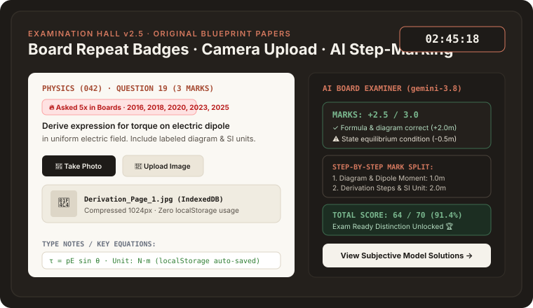
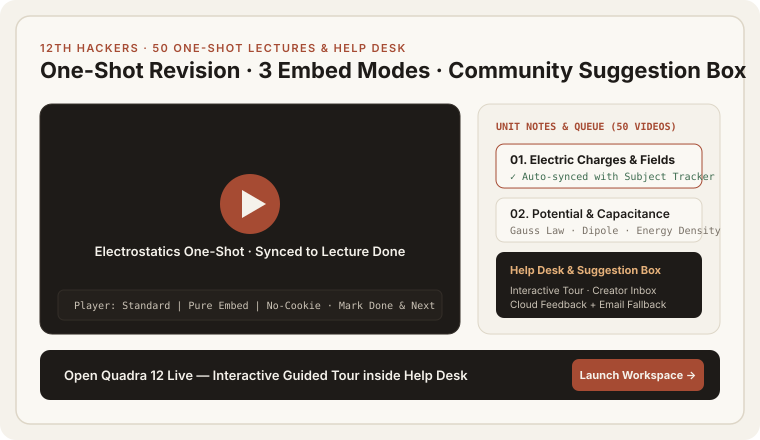

# Quadra 12

**Live Website:** [https://ariyanpal1008.github.io/Quadra12/](https://ariyanpal1008.github.io/Quadra12/)  
**GitHub Repository:** [https://github.com/Ariyanpal1008/Quadra12](https://github.com/Ariyanpal1008/Quadra12)  
**AI Summary (llms.txt):** [https://ariyanpal1008.github.io/Quadra12/llms.txt](https://ariyanpal1008.github.io/Quadra12/llms.txt)  
**Full AI Knowledge Base (llms-full.txt):** [https://ariyanpal1008.github.io/Quadra12/llms-full.txt](https://ariyanpal1008.github.io/Quadra12/llms-full.txt)  
**Creator:** AriYan Pal (Keśava Dāsa) · `ariyanpal090@gmail.com`  
**Copyright:** © 2026 Quadra 12 · Creator: AriYan Pal (Keśava Dāsa)

Quadra 12 is a calm, distraction-free Class 12 CBSE PCMB (Physics 042, Chemistry 043, Biology 044, and Mathematics 041) academic preparation workspace. It brings together an Apple StandBy–inspired **Live Board Exam Countdown Clock**, a gamified **My Achievements** milestone system, comprehensive syllabus tracking across all 50 NCERT chapters, full-length official CBSE 2026–27 Sample Question Paper practice in a 3-hour **Examination Hall**, and 50 synced **12th Hackers** one-shot video lectures in one unified web application.

---

## Visual Showcase (Click Any Card to Launch Live)

> Click any visual preview below to launch **Quadra 12** directly, or explore the in-app **Help Desk → Interactive Tour** to test real interactive widgets, countdown clocks, milestone seals, and OMR bubbles.

| Overview: Live Board Clock & Achievements | Subject Tracker: 50 Chapters & SVG Plates |
| :---: | :---: |
| [](https://ariyanpal1008.github.io/Quadra12/) | [](https://ariyanpal1008.github.io/Quadra12/) |
| **Live 1s Chronometer** (`16 Feb · 10:30 AM IST`, auto `2027 → 2028` rollover) + **My Achievements** (`Quick Learner`, `Exam Ready`). | **50 NCERT Chapters × 4 Stages** (`Lecture`, `Practice`, `NCERT`, `PYQ`) + 50 bespoke interactive vector study plates. |

| Examination Hall: 3-Hour CBSE SQP & OMR | 12th Hackers & Help Desk Interactive Tour |
| :---: | :---: |
| [](https://ariyanpal1008.github.io/Quadra12/) | [](https://ariyanpal1008.github.io/Quadra12/) |
| **Official CBSE 2026–27 PDFs**, `03:00:00` exam clock, interactive Section A OMR auto-grading, and per-subject best scores. | **50 One-Shot Lectures** synced to `Lecture done`, 3 player embed modes, **Interactive Tour**, & Cloud Suggestion Box. |

<details>
<summary><strong>Step-by-Step Interactive Guide — How to Use Quadra 12</strong></summary>

1. **Live Board Exam Countdown Clock (`Overview`):** Counts every second down to **16 Feb at 10:30 AM IST**. Features rolling flip-clock digits, pacing urgency badges, and an **Auto: Feb 16 / Custom Date** picker. It automatically rolls over to the next year's exam once the current date passes.
2. **My Achievements (`Overview`):** Click the compact **My Achievements** card to inspect all **9 Milestone Seals**, including **First Step**, **Quick Learner** (`3–5` chapters in one day), **Syllabus Sprinter** (`5` chapters in a single calendar day), **Four-Stage Purist**, **Subject Champion**, **Hall Debut**, **Exam Ready** (`>90%` score on a CBSE sample paper), **One-Shot Scholar**, and **Quadra 12 Grandmaster** (`50/50` chapters). Live unlock banners notify you from any view.
3. **Subject Tracker:** Expand Physics (`14`), Chemistry (`10`), Biology (`13`), or Mathematics (`13`) chapters. Check off **Lecture**, **Practice**, **NCERT**, and **PYQ** checkpoints, view subject-level progress percentages, or inspect each chapter's custom interactive SVG illustration.
4. **Examination Hall:** Select Physics (`042`), Chemistry (`043`), Biology (`044`), or Mathematics (`041`) to load the official, unmodified CBSE 2026–27 Sample Question Paper PDF beside the 3-hour timer and interactive OMR answer sheet with automated scoring.
5. **12th Hackers:** Stream unit-curated one-shot video lectures with key formulas, summaries, and timestamps. Checking off a lecture automatically updates `Lecture done` in the Subject Tracker.
6. **Help Desk & Interactive Tour:** Access the **Help Desk** to explore the interactive visual tour sandbox, read syllabus notes, submit suggestions or bug reports via Google Sign-In, or access the Creator Inbox.
7. **Terms & Conditions:** Tap the dull blue **Terms & Conditions · 2026** link in the footer to review the standalone Copyright, Fair Use, and Takedown Policy modal.
8. **GitHub Repository:** Click the official bold **GitHub** link in the footer to inspect source code, contribute, or star the repository.

</details>

---

## About the Creator

I am **AriYan Pal (Keśava Dāsa)** (`ariyanpal090@gmail.com`), a Class 12 student preparing for board exams.

- **The Problem:** Staying organized across Physics, Chemistry, Biology, and Mathematics without getting overwhelmed by clutter, ads, or disorienting apps was a major challenge during board prep.
- **The Solution:** I created **Quadra 12** to provide a calm, aesthetic, and completely focused study sanctuary tailored for Class 12 PCMB students.

---

## Key Features & Capabilities

### 1. Live Board Exam Countdown Clock
- Apple StandBy–inspired minimalist chronometer updating every second with rolling flip-card digits.
- Targets official CBSE Board Exam kick-off: **16 February at 10:30 AM IST**.
- Intelligent annual rollover: automatically resets to **16 February 2028** once 2027 exams begin.
- Built-in **Auto: Feb 16 / Custom Date** selector allowing students to adjust target dates if official schedules shift.
- Dynamic daily chapter pace calculator and urgency indicator.

### 2. Gamified Milestone Badges (My Achievements)
- Accessible via a compact overview trigger card that opens a dedicated milestone dialog.
- 9 milestone seals:
  - **First Step:** Complete your first chapter across all 4 stages.
  - **Quick Learner:** Complete 3 or more chapters in a single calendar day.
  - **Syllabus Sprinter:** Complete 5 or more chapters in a single day.
  - **Four-Stage Purist:** Check off Lecture, Practice, NCERT, and PYQ for 10 chapters.
  - **Subject Champion:** Achieve 100% completion in any single subject.
  - **Hall Debut:** Complete your first 3-hour Examination Hall paper.
  - **Exam Ready:** Score 90% or higher on an official CBSE sample paper.
  - **One-Shot Scholar:** Watch and complete 25 12th Hackers lectures.
  - **Quadra 12 Grandmaster:** Complete all 50 chapters across Physics, Chemistry, Biology, and Mathematics.
- Non-intrusive floating unlock toast notifications with soundless, smooth Motion entrance.

### 3. Subject Tracker (50 NCERT Chapters)
- Detailed tracking for **Physics (042)**, **Chemistry (043)**, **Biology (044)**, and **Mathematics (041)**.
- 4 study stages per chapter: **Lecture**, **Practice**, **NCERT Intext/Exercises**, and **PYQs**.
- 50 custom-crafted interactive SVG vector study diagrams providing visual recall for key concepts.
- 100% completion celebration banner with subtle gold shimmer.

### 4. Examination Hall (CBSE 2026–27 SQP Simulation)
- Official unmodified CBSE 2026–27 Sample Question Paper PDFs embedded directly in-app.
- Realistic 3-hour (`03:00:00`) countdown chronometer with pause, resume, and reset controls.
- Interactive digital OMR sheet for Section A with automatic scoring, accuracy analytics, and best score persistence.

### 5. 12th Hackers One-Shot Video Workspace
- Curated queue of 50 comprehensive one-shot YouTube lectures aligned with the latest syllabus.
- Bidirectional synchronization: marking a video done checks off the chapter's `Lecture` task in the Subject Tracker.
- 3 playback options: Standard Player, Pure Mode, and Privacy-Enhanced (`youtube-nocookie.com`).
- Direct "Open on YouTube" and "Mark Done & Next" shortcuts.

### 6. Help Desk, Interactive Tour & Standalone Terms Modal
- 5 clean Help Desk tabs: **Interactive Guide**, **Interactive Tour** (sandbox preview widgets), **Creator & Disclaimers**, **Suggest Addition / Change**, and **Creator Inbox**.
- Dedicated **Upcoming 2027 App Updates** section inside About & Disclaimers noting upcoming 5th/6th subject additions (English Core, Physical Education, Computer Science, Fine Arts) and community suggestions post-boards.
- Standalone **Terms & Conditions · 2026** modal accessible directly from the footer with fair use and copyright takedown details.
- Footer features high-resolution official vector **GitHub** logo (`Octicons-mark-github_12794390.svg`) linking to the GitHub repository.

### 7. Footer 2027 Announcement & Non-Overlap Sticky Header
- **Footer "Coming in 2027" Card:** Positioned above the copyright line, featuring a dark pill badge `New Subjects in 2027` and a warm-cream secondary container announcing future post-board subject expansions (English Core, Physical Education, Computer Science, Fine Arts).
- **Solid Frosted Header (No Text Overlap):** Upgraded sticky top navigation bar with `#FAF8F5` (Light) and `#121212` (Dark) background, `backdrop-filter: blur(10px)`, and subtle bottom divider (`rgba(0,0,0,0.06)`), preventing underlying headings and cards from clashing or overlapping during scrolling on desktop and mobile.

### 8. Zero-Dependency Web Audio API Sound System
- **Synthesized Micro-Interactions (<200ms):** Native browser `AudioContext` synthesizes tactile sounds on the fly with no external audio files required.
  - **Chapter Checkboxes (Lecture, Practice, NCERT, PYQ):** Crisp, low-volume tactile pop (sine/triangle rapid pitch sweep, ~60ms) on check, softer reverse tick on uncheck.
  - **Theme Switch (Light/Dark Mode):** Subtle mechanical switch click (~40ms).
  - **OMR Bubble Selection (Examination Hall):** Soft, muted option tap sound (~45ms).
  - **Achievement Unlocked & 100% Subject Mastery:** Warm, two-note harmonic chime (C5 → G5, soft decay ~300ms).
  - **Exam Timer Completion:** Gentle, non-jarring multi-tone bell chime when the 3-hour timer reaches `00:00:00`.
- **Header Sound Toggle:** Compact mute/unmute button (🔊 / 🔇) in the sticky navbar directly next to the theme toggle, persisted in `localStorage`.
- **Subtle Haptics:** Subtle gain levels (0.08–0.15 max) and automatic gesture unlock compliant with browser autoplay policies.

### 9. Official Settings (v2.4), Account-less Cloud Sync & Three.js 3D Study Studio
- **Clean `☰ → Settings` Entry:** The `☰` three-lines mobile menu contains `Overview`, `Subject Tracker`, `Examination Hall`, `12th Hackers`, **`Settings`**, **`About the Creator`**, and **`Help Desk`**—kept clutter-free with no redundant Sound Effects row inside `☰`. Tapping **Settings** opens all 7 organized panels:
  1. **Cloud Sync:** Transfer progress between laptops (using a **6-digit numeric Sync Code**) and phones (using a **scannable QR code** `?sync=XXXXXX`) without signing in. Includes an optional small **Camera QR Scanner icon** right beside the 6-digit code input (requests browser camera permission *"Only this time / While using"* strictly on click, decodes with `jsQR`, and shuts off the camera immediately after pairing), plus Auto-Sync and `.json` offline backup export/restore.
  2. **Audio & Tactile:** Sound mute/unmute toggle, 6 interactive Web Audio micro-sound test buttons, and Light/Dark appearance switch.
  3. **3D Studio:** Full-viewport Three.js WebGL interactive studio featuring silky-smooth antialiased rendering, damped OrbitControls, a collapsible **left-side project switcher rail**, camera presets (`3/4`, `Top`, `Side`), auto-orbit toggle, and an Explode Model slider across **Physics** (Moving-Coil Galvanometer), **Chemistry** (`[ML₆]` Octahedral Complex), **Biology** (DNA Double Helix), **Mathematics** (`a × b` Cross Product & Double Cone), and the **Grandmaster Achievement Trophy**.
  4. **Exam & Urgency:** Custom board exam countdown date selector, Official Feb 16 reset, **Urgency Alert Window** (`15 / 30 / 60 / 90 days`), and Daily Chapter Pace Hint toggle.
  5. **Player & Video:** Persistent default YouTube embed engine (`Standard Sync`, `Pure Embed`, or `Privacy No-Cookie`) and Auto-Advance Next Lecture toggle.
  6. **Privacy & Reset:** Live `localStorage` **Storage Quota Meter** (`KB / MB` out of `5 MB`), **Reset Single Subject** controls (reset Physics, Chemistry, Biology, or Math individually without affecting other subjects), and **Master Reset (Danger Zone)** protected by a **double-confirmation pop-up**.
  7. **About & Links:** **Version 2.4** badge, creator stamp (`AriYan Pal / Keśava Dāsa`), and quick launch buttons for **Terms & Conditions · 2026** and the **Official GitHub Repository**.

---

## System Architecture

```text
Quadra12/
├── .github/workflows/deploy.yml           # Automated GitHub Pages CI/CD workflow (Node 22)
├── public/
│   ├── assets/
│   │   ├── aistudio/                      # Official CBSE SQP PDFs & vector brand assets
│   │   └── showcase/                      # Interactive SVG preview cards for README
│   ├── favicon.svg                        # Scalable SVG brand emblem
│   ├── google5e9a994eb74ab809.html        # Google Search Console verification token
│   ├── llms.txt                           # Structured summary for AI assistants & search indexers
│   ├── robots.txt                         # Search engine crawler instructions
│   └── sitemap.xml                        # XML sitemap for SEO discovery
├── src/
│   ├── components/
│   │   ├── AchievementsSection.tsx        # Compact trigger card & Achievements dialog
│   │   ├── BoardCountdownClock.tsx        # Apple StandBy live countdown chronometer
│   │   ├── ChapterIllustrations.tsx       # 50 bespoke chapter SVG illustrations
│   │   ├── ErrorBoundary.tsx              # Robust fallback boundary for errors
│   │   ├── ExamDiagrams.tsx               # Examination visual diagram plates
│   │   ├── ExamHallSection.tsx            # 3-hour CBSE SQP simulator + OMR grader
│   │   ├── FluidPrimitives.tsx            # Apple springs, animated numbers & scroll reveals
│   │   ├── HackersPlaylistSection.tsx     # 12th Hackers playlist and notes interface
│   │   ├── HelpDeskModal.tsx              # Guide, Tour, Disclaimers & Feedback modal
│   │   ├── InteractiveTourTab.tsx         # Interactive feature sandbox walkthrough
│   │   ├── ResilientImage.tsx             # Fault-tolerant image component
│   │   ├── SettingsModal.tsx              # Official Settings (6-digit + QR Cloud Sync, Audio, Data)
│   │   ├── SubjectTrackerSection.tsx      # 50-chapter PCMB syllabus tracker
│   │   ├── TermsModal.tsx                 # Standalone Terms & Conditions dialog
│   │   ├── ThreeLabModal.tsx              # Interactive Three.js 3D WebGL Study Studio
│   │   └── YouTubeSyncPlayer.tsx          # Multi-mode synchronized video player
│   ├── data/
│   │   ├── achievements.ts                # 9 milestone rules & unlock velocity logic
│   │   └── pcmbData.ts                    # Canonical CBSE syllabus, SQPs & playlist records
│   ├── utils/
│   │   ├── cloudSync.ts                   # Account-less 6-digit + QR Firestore sync & JSON backup
│   │   └── soundEffects.ts                # Zero-dependency Web Audio API micro-sound synthesizer
│   ├── App.tsx                            # Root application layout, navigation & footer
│   ├── firebase.ts                        # Firebase Auth (Google Sign-In) & Firestore integration
│   ├── index.css                          # Tailwind CSS v4 directives & typography tokens
│   └── main.tsx                           # React entry point with ErrorBoundary
├── firebase-applet-config.json            # Public Firebase client config
├── firebase-blueprint.json                # Cloud Firestore database schema
├── firestore.rules                        # Secure Firestore security rules
├── index.html                             # SEO meta tags, OpenGraph, Twitter Cards & JSON-LD
├── package.json                           # NPM dependencies and scripts
└── vite.config.ts                         # Vite configuration with relative base: './'
```

---

## Data & Persistence Architecture

### 1. Local Browser Storage (`localStorage`)
All personal study records, timestamps, and exam scores are preserved locally in the student's browser with zero login required:

| Key | Type | Description |
| :--- | :--- | :--- |
| `pcmb_desk_completed_chapters_v1` | `Record<string, boolean>` | Map of completed chapter IDs |
| `pcmb_desk_chapter_tasks_v1` | `Record<string, ChapterTaskState>` | 4-stage task checkboxes per chapter (`lecture`, `practice`, `ncert`, `pyq`) |
| `pcmb_desk_watched_lectures_v1` | `Record<string, boolean>` | Watched status for all 50 one-shot lectures |
| `pcmb_desk_best_scores_v1` | `Partial<Record<SubjectId, ExamAttemptSummary>>` | Highest examination score and accuracy per subject |
| `pcmb_desk_daily_chapter_log_v1` | `Record<string, string[]>` | Daily completed chapter history (`YYYY-MM-DD`) for sprint achievements |
| `pcmb_desk_achievements_v1` | `Partial<Record<AchievementId, UnlockedAchievementRecord>>` | Timestamps and metadata of unlocked milestone seals |
| `pcmb_desk_custom_board_date_v1` | `string` (`YYYY-MM-DD`) | User-configured exam countdown date override |
| `pcmb_desk_urgency_days_v1` | `'15' \| '30' \| '60' \| '90'` | Countdown final alert threshold window |
| `pcmb_desk_show_pace_v1` | `'true' \| 'false'` | Daily chapter pacing summary visibility |
| `pcmb_desk_embed_mode_v1` | `'standard' \| 'pure' \| 'nocookie'` | Default 12th Hackers YouTube embed player |
| `pcmb_desk_auto_advance_v1` | `'true' \| 'false'` | Auto-advance next lecture upon completion |
| `pcmb_desk_sound_muted_v1` | `string` (`'true'` \| `'false'`) | User sound effects mute/unmute preference |
| `pcmb_desk_theme_v1` | `'light' \| 'dark'` | UI theme preference |
| `pcmb_desk_sync_code_v1` | `string` (`6 digits`) | Active account-less Cloud Sync pairing code |
| `pcmb_desk_auto_sync_v1` | `'true' \| 'false'` | Debounced automatic Cloud Sync toggle |
| `pcmb_desk_last_synced_v1` | `string` (ISO timestamp) | Timestamp of last successful Cloud Sync operation |

### 2. Cloud Firestore (`syncSessions` & `changeRequests` Collections)
- **`syncSessions/{syncCode}`:** Account-less cross-device synchronization keyed by a 6-digit numeric code (and QR code URL `?sync=XXXXXX`). Collection listing (`allow list: if false`) is strictly blocked so user sync sessions cannot be enumerated or scraped.
- **`changeRequests`:** Used for user suggestions and change requests submitted via Google Sign-In:

- `authorUid` (`string`) — Submitter's Firebase Auth UID.
- `authorName` (`string`) — Submitter's display name.
- `category` (`'addition' | 'change' | 'syllabus_fix' | 'bug_report'`) — Category of suggestion.
- `targetSection` (`'general' | 'overview' | 'subjects' | 'exam' | 'hackers'`) — Relevant app section.
- `title` (`string`, 3–120 chars) — Suggestion title.
- `details` (`string`, 5–1500 chars) — Detailed feedback or report.
- `status` (`'new' | 'planned' | 'added'`) — Status badge.
- `creatorNote` (`string`, max 500 chars) — Official response note from the creator.
- `createdAt` / `updatedAt` — Firestore server timestamps.

---

## Tech Stack

- **Framework:** React 19, TypeScript
- **Bundler:** Vite 8 (configured with `base: './'` for GitHub Pages)
- **3D & QR Pairing:** Three.js (`WebGLRenderer`, `OrbitControls`, `RoomEnvironment`), `qrcode`, & `jsqr` (in-app camera QR scanner)
- **Styling:** Tailwind CSS v4 (`@tailwindcss/vite`)
- **Animations:** Motion (`motion/react`) with custom Apple spring presets
- **Icons:** Lucide Icons & official Octicons GitHub SVG
- **Backend / Authentication:** Firebase Authentication (Google Sign-In) & Cloud Firestore
- **Deployment:** GitHub Pages via GitHub Actions (`.github/workflows/deploy.yml`)
- **SEO & Discoverability:** Canonical links, OpenGraph, Twitter Cards, Schema.org `WebApplication` JSON-LD, `llms.txt`, `llms-full.txt`, `robots.txt`, and `sitemap.xml`

---

## Release v2.4 Highlights

- **Official Settings (`v2.4`):** Accessible via a clean `Settings` trigger inside the sticky `☰` drawer and desktop header across 7 dedicated panels (**Cloud Sync**, **Audio & Tactile**, **3D Studio**, **Exam & Urgency**, **Player & Video**, **Privacy & Reset**, and **About & Links**).
- **Account-less Cloud Sync & Optional Camera QR Scanner:** Sync study progress between laptops and mobiles without login using a **6-digit numeric Sync Code**, a live scannable **QR Code** (`?sync=XXXXXX`), or the compact **Camera QR Scanner icon** right beside the 6-digit code box (on-demand browser camera prompt + instant auto-pair), plus **Auto-Sync** and offline `.json` backup export/restore.
- **Three.js 3D Study Studio:** Interactive WebGL models for **Physics**, **Chemistry**, **Biology**, **Maths**, and the **Grandmaster Trophy** with orbit/zoom, camera presets, and an Explode Model slider.
- **Safety & Privacy Controls:** Local storage quota meter (`KB` / `MB` out of `5 MB`), isolated single-subject resets (including clearing that subject's best exam score cleanly), and **Master Reset (Danger Zone)** with a 2-step double-confirmation pop-up.
- **AI Discoverability & Clean Menu:** Removed redundant `Sound Effects` row from `☰`, kept `About the Creator` distinct from Settings `About & Links`, and synced `README.md`, `index.html`, `llms.txt`, and `llms-full.txt`. (See `RELEASE_NOTES_v2.4.md` for copy-ready GitHub Release notes.)

---

## Local Development & Build

```bash
# 1. Clone repository
git clone https://github.com/Ariyanpal1008/Quadra12.git
cd Quadra12

# 2. Install dependencies
npm install --legacy-peer-deps

# 3. Start local development server
npm run dev

# 4. Type check with TypeScript compiler
npm run lint

# 5. Build for production (outputs to dist/)
npm run build
```

---

## Disclaimers, Terms &amp; Conditions (Copyright &amp; Fair Use)

- **Independent Student Initiative:** Quadra 12 is an independent, non-commercial educational study workspace. Students should always cross-reference official circulars, examination schedules, and syllabus announcements on [cbse.gov.in](https://cbse.gov.in).
- **Intellectual Property & Ownership:** The original Quadra 12 interface, custom vector SVG study diagrams, countdown algorithms, and achievement seals remain the property of Quadra 12. Official CBSE 2026–27 Sample Question Papers belong to the Central Board of Secondary Education, and all embedded 12th Hackers YouTube lectures belong to their original educators and creators; Quadra 12 organizes them strictly for student revision convenience.
- **Copyright Claims & Takedown Policy:** If you are a copyright owner or authorized agent and believe any content or link on Quadra 12 infringes your copyright or wish it removed, please contact `ariyanpal090@gmail.com` with: (a) identification of the copyrighted work, (b) the exact section on Quadra 12, and (c) your contact information. Valid inquiries are addressed promptly.
- **No Warranty:** Timers, study schedules, and self-graded OMR answer keys are provided "as is" without warranty; clearing local browser data resets local study progress.

---

© 2026 Quadra 12 · Creator: AriYan Pal (Keśava Dāsa)
