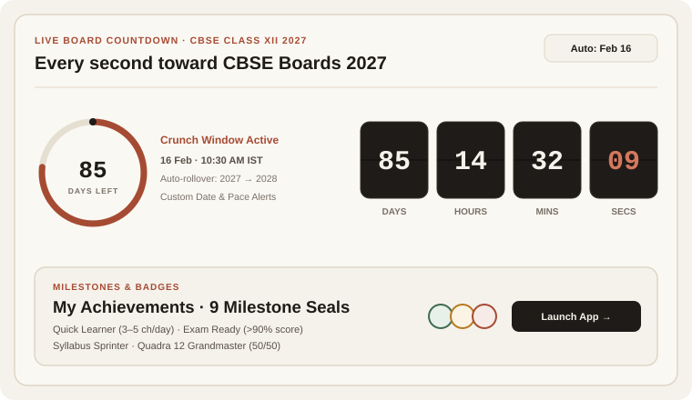
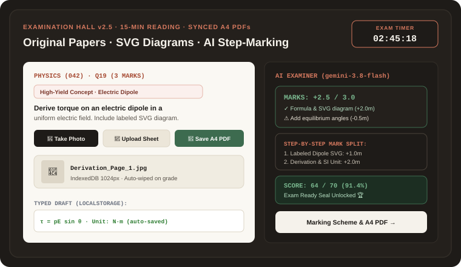
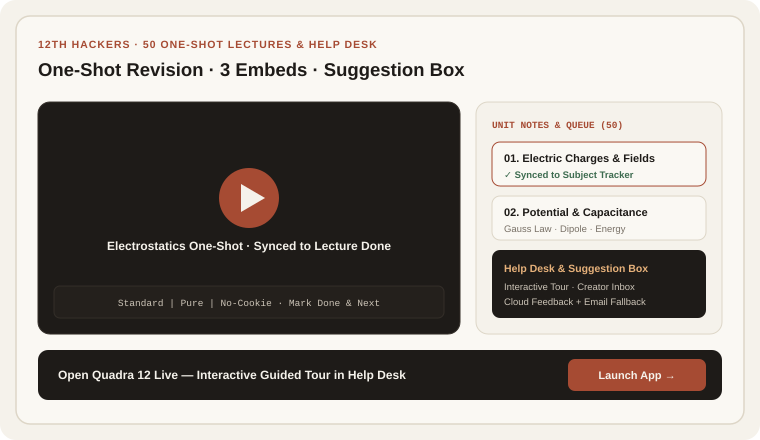

# Quadra 12 (v3.0.0)

[](https://github.com/Ariyanpal1008/Quadra12/releases/tag/v3.0.0)
[-A64B33.svg?style=flat-square)](#installable-offline-pwa--signed-android-apk-0)
[](#examination-hall-v300--deterministic-omr-practice-mode--archive)
[](#tech-stack)

> **Quadra 12 v3.0.0 Major Release:** Introduces **4 complete Subject Study Libraries** covering all 50 NCERT chapters, a **720-question Verified Practice Bank** (`180` questions per subject across Physics, Chemistry, Biology, and Mathematics), a **human-approved Exam Governance & Deterministic OMR Engine** with key stripping during live tests, **unconditional Practice Sheet & Marking Scheme access even at `0` marks**, offline local A4 PDF export (`Practice Sheet PDF` + `Marking Scheme PDF`), **Multi-Student Profile isolation** with non-destructive preservation of all v2.6.2 student data, a dedicated read-only **2026–27 CBSE SQP Archive**, zero external exam AI dependencies, upgraded Offline PWA Service Worker updates (`quadra12-v3.0.0`), and **Signed Android `.apk` (`Quadra12-v3.0.0-Android.apk`)**.

- **Current Version:** `v3.0.0`
- **Live Web & PWA App:** [https://ariyanpal1008.github.io/Quadra12/](https://ariyanpal1008.github.io/Quadra12/) *(Installable offline on Android, iOS/iPadOS, Windows & macOS)*
- **Free Signed Android `.apk` Download:** [GitHub Releases (`Quadra12-v3.0.0-Android.apk`)](https://github.com/Ariyanpal1008/Quadra12/releases/tag/v3.0.0) *(100% Free — `$0`)*
- **GitHub Repository:** [https://github.com/Ariyanpal1008/Quadra12](https://github.com/Ariyanpal1008/Quadra12)
- **Historical v2.6.2 Archive Notes:** [`RELEASE_NOTES_v2.6.2.md`](RELEASE_NOTES_v2.6.2.md)
- **Creator:** AriYan Pal (Keśava Dāsa) · `ariyanpal090@gmail.com`
- **Copyright:** © 2026 Quadra 12 · Creator: AriYan Pal (Keśava Dāsa)

---

## Visual Showcase

| Overview: Live Board Clock & Achievements | Subject Tracker: 50 Chapters & Study Libraries |
| :---: | :---: |
| [](https://ariyanpal1008.github.io/Quadra12/) | [](https://ariyanpal1008.github.io/Quadra12/) |
| **Live 1s Chronometer** (`16 Feb · 10:30 AM IST`, auto `2027 → 2028` rollover) + **My Achievements** (`Quick Learner`, `Exam Ready`). | **50 NCERT Chapters × 4 Checkpoints + Study Libraries** + explicit `ChapterStudyStatus` (`Not Started / In Progress / Reviewed / Completed`). |

| Examination Hall: OMR, Practice Mode & PDFs | 12th Hackers & Help Desk Interactive Tour |
| :---: | :---: |
| [](https://ariyanpal1008.github.io/Quadra12/) | [](https://ariyanpal1008.github.io/Quadra12/) |
| **8 Published Single-Choice OMR Papers**, **720 Verified Practice Qs**, **Unconditional 0-Mark Result Review**, & **Local A4 PDFs**. | **50 One-Shot Lectures** synced to `Lecture done`, 3 player embed modes, **Interactive Tour**, & Cloud Suggestion Box. |

---

## What's New in Quadra 12 v3.0.0

### 1. Four Subject Study Libraries — Formula Sheets, Derivation Sheets & 94 Diagrams (50 NCERT Chapters)
- Complete subject study repositories (`src/data/studySheets/{physics,chemistry,biology,maths}StudyLibrary.ts`) mapping all **50 NCERT Class 12 chapters** with dedicated, cleanly separated study reference sheets (separate from MCQ exam papers):
  - **Physics (`042`) — 14 chapters:** 15 formula sheets, **21 full step-by-step textbook derivations** across all 14 chapters, and **29 vector diagrams & graphs**.
  - **Mathematics (`041`) — 13 chapters:** 26 formula & standard method sheets, **13 step-by-step derivations & proofs** across all 13 chapters, and **19 graphs & geometric figures**.
  - **Chemistry (`043`) — 10 chapters:** 11 formula, reaction-mechanism & trend sheets, **3 quantitative Physical Chemistry derivations**, and **19 diagrams & plots**.
  - **Biology (`044`) — 13 chapters:** 13 pathway, genetics & law sheets and **26 labelled biological diagrams & graphs**.
- Modular SVG figure & graph modules (`src/data/diagrams/{physics,chemistry,biology,maths}Diagrams.ts` + `src/data/diagramSvgs.ts` registered in `src/data/v3Diagrams.ts`, **94 total SVG diagrams/graphs**) rendered cleanly inside `SubjectTrackerSection.tsx` across **4 dedicated chapter tabs** (`Formula Sheet`, `Derivation Sheet`, `Diagrams & Graphs`, `Practice Qs`) plus a **Complete Subject Formula, Derivation & Diagram Sheet** modal with chapter filters and **Print / Save PDF**.

### 2. 720-Question Verified Practice Bank (`180` per Subject)
- Authored across clean subject-modular files (`src/data/questionBank/{physics,chemistry,biology,maths}Questions*.ts`) with exact coverage:
  - Physics: `180` verified MCQs (`10–15` per chapter)
  - Chemistry: `180` verified MCQs (`18` per chapter)
  - Biology: `180` verified MCQs (`12–15` per chapter)
  - Mathematics: `180` verified MCQs (`12–15` per chapter)
- Powers both untimed **Practice Mode** (`PracticeModeView.tsx`) with instant explanations/chapter filters and **Timed OMR Mock Papers**.

### 3. Examination Hall — Deterministic OMR, Audit Settings & Archive
- **8 Published Single-Choice OMR Papers (`src/data/verifiedPapers.ts`):** Each PCMB subject features **Full-Syllabus Competitive Mock Paper I (`+4/−1`)** and **CBSE Board Sprint Paper II (`+1/0`)** with full deterministic `VerifiedMarkingScheme`s, clean `Quadra 12` branding, and subject cards displaying `Best` scores once attempted.
- **Human-Approved Publication Gatekeeper (`canPublishExamPaper`):** Live OMR exams admit papers only when `status` is `'Approved'` or `'Published'` AND a matching `'Approved'`/`'Published'` `VerifiedMarkingScheme` covers every question. **Verified Paper Audit & Marking-Scheme Standards** (`AuthorReviewPanel.tsx`) is available inside **Settings → Exam & Paper Audit**, keeping the student Examination Hall focused cleanly on tests.
- **Live Key Stripping (`stripAnswerKeysForActiveExam`):** Strips `correctIndex` and `subjectiveSolution` while an active OMR exam is in progress.
- **Unconditional Result Access Even at `0` Marks (`evaluateOmrSubmission` + `ExamResultView.tsx`):** Submitting any attempt — even an empty `0`-mark or negative net score attempt — always opens the full Question Breakdown, Marking Scheme, immutable `PracticeSheetSnapshot`, linked Study Library chapters, Diagrams, and both offline A4 PDF exports.
- **Read-Only 2026–27 SQP Archive (`ArchiveExamView.tsx`):** Preserves historical CBSE v2.6.2 Section A–E sample papers in a separate read-only Archive view without colliding with governed OMR assessments.

### 4. Local A4 PDF Generation & Multi-Student Profile Isolation
- **Offline A4 PDFs (`ExamPdfModal.tsx` & `pdfExporter.ts`):** Generates clean A4 **Practice Sheet PDF** (immutable snapshot or untouched Main Sheet) and **Marking Scheme PDF** completely offline via `jsPDF`, working in Web browsers, Offline PWA, and Android APK (`Downloads/Quadra12/`).
- **Multi-Student Profiles & Safe Migration (`v3Storage.ts`):** Multiple local student profiles isolate OMR drafts, submitted attempts, immutable `PracticeSheetSnapshot`s, and explicit `ChapterStudyStatus` (`Not Started | In Progress | Reviewed | Completed`). `ensureV2ToV3SafeMigration()` preserves all **17 legacy v2.6.2 `localStorage` keys** without mutating existing board prep data.

### 5. Zero External Exam AI Dependencies
- Removed `server/geminiFailover.ts`, `server/geminiFailover.test.ts`, `@google/genai`, `/api/exam/grade`, `GEMINI_API_KEYS`, `GEMINI_API_KEY`, `VITE_GEMINI_API_KEYS`, and `VITE_PROXY_URL` across server, build, CI workflows, and frontend.
- `server.ts` provides CORS-allowlisted `GET /api/health` (`version: '3.0.0'`, `mode: 'deterministic-local-exam-engine'`) and SPA delivery.
- Firebase Cloud Sync (`syncSessions`), Help Desk (`changeRequests`), 12th Hackers playlists, 3D WebGL Lab, Web Audio sound effects, Achievements, Board Countdown, and all Android signing configurations are preserved intact.

---

## Installable Offline PWA & Signed Android `.apk` (`$0`)

- **Web & Offline PWA:** Managed via `vite-plugin-pwa` (`injectManifest` via `src/sw.js` cache `quadra12-v3.0.0-*`), delivering instant asset precaching and an in-app `"Offline App Update Ready · Reload App"` notification prompt (`src/main.tsx` + `src/App.tsx`).
- **Signed Android `.apk` (`Quadra12-v3.0.0-Android.apk`):** Built in `.github/workflows/android-release.yml` via Capacitor 8 + Gradle (`scripts/configure-android.mjs` with monotonic `versionCode = 3000 + GITHUB_RUN_NUMBER`) and verified with `apksigner` against Quadra 12's permanent release keystore (`ANDROID_KEYSTORE_BASE64`, `ANDROID_KEY_ALIAS`, `ANDROID_KEYSTORE_PASSWORD`, `ANDROID_KEY_PASSWORD`).

---

## Local Development, Verification & Deployment

```bash
# 1. Clone repository
git clone https://github.com/Ariyanpal1008/Quadra12.git
cd Quadra12

# 2. Install dependencies
bun install --frozen-lockfile

# 3. Run unit tests, TypeScript & lint verification, and production build
npm test
npm run lint
npm run build

# 4. Run production Node/Express server (tsx is in production dependencies)
npm start
```

Check server health locally or on your Node host:

```bash
curl http://localhost:3000/api/health
```

---

## Tech Stack

- **Frontend:** React 19, TypeScript, Vite 8 (`base: './'`), Tailwind CSS v4, Motion (`motion/react`), Lucide Icons
- **3D, PDF & Sync:** Three.js WebGL Lab, `jsPDF` + `html2canvas-pro`, QRCode + jsQR, Native Web Audio API, Firebase Firestore (`syncSessions` & `changeRequests`)
- **Offline & Mobile:** `vite-plugin-pwa` (`injectManifest` Service Worker), Capacitor 8 Android (`MainActivity.java` `QuadraAndroid` bridge)
- **Server:** Express + `tsx server.ts`

---

© 2026 Quadra 12 · Creator: AriYan Pal (Keśava Dāsa) · `ariyanpal090@gmail.com`
