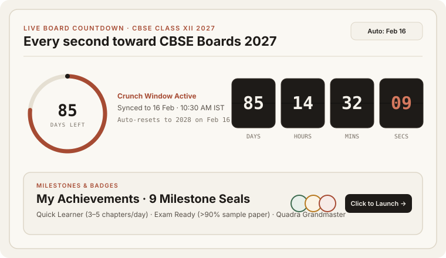

# Quadra 12

**Live Website:** [https://ariyanpal1008.github.io/Quadra12/](https://ariyanpal1008.github.io/Quadra12/)  
**Repository:** [https://github.com/Ariyanpal1008/Quadra12](https://github.com/Ariyanpal1008/Quadra12)  
**Creator:** AriYan Pal (Keśava Dāsa) · `© 2026 Quadra 12` (Invented November 2026)

Quadra 12 is an independent Class 12 CBSE PCMB (Physics, Chemistry, Biology, and Mathematics) study workspace. It unifies a live **Board Exam Countdown Clock**, a gamified **My Achievements** milestone system, syllabus tracking across 50 NCERT chapters, full-length official CBSE 2026–27 Sample Question Paper practice inside a timed Examination Hall, and 50 synced **12th Hackers** one-shot video lectures in one calm, distraction-free web application.

---

## Visual Walkthrough (Click Any Card to Launch Live)

> Click any preview below to open **Quadra 12** live, or open **Help Desk → Interactive Tour** inside the website to test buttons, checkboxes, countdown urgency, achievement unlocks, and OMR bubbles directly.

| Overview: Live Board Clock & Achievements | Subject Tracker: 50 Chapters & SVG Plates |
| :---: | :---: |
| [](https://ariyanpal1008.github.io/Quadra12/) | [](https://ariyanpal1008.github.io/Quadra12/) |
| **Live 1s Chronometer** (`16 Feb · 10:30 AM IST`, auto `2027 → 2028` rollover) + **My Achievements** (`Quick Learner`, `Exam Ready`). | **50 NCERT Chapters × 4 Stages** (`Lecture`, `Practice`, `NCERT`, `PYQ`) + 50 interactive study diagrams. |

| Examination Hall: 3-Hour CBSE SQP & OMR | 12th Hackers & Help Desk Interactive Tour |
| :---: | :---: |
| [](https://ariyanpal1008.github.io/Quadra12/) | [](https://ariyanpal1008.github.io/Quadra12/) |
| **Official CBSE 2026–27 PDFs**, `03:00:00` exam clock, interactive Section A OMR auto-grading, and best score saving. | **50 One-Shot Lectures** synced to `Lecture done`, 3 player embed modes, **Interactive Tour**, & Cloud Suggestion Box. |

<details>
<summary><strong>Step-by-Step Interactive Guide — How to Use Quadra 12</strong></summary>

1. **Live Board Exam Countdown Clock (`Overview`):** Counts every second down to **16 Feb at 10:30 AM IST**. Automatically resets to **16 Feb 2028** once 2027 boards start (and repeats yearly), with an **Auto: Feb 16 / Custom Date** selector if CBSE adjusts a future exam start date.
2. **My Achievements (`Overview`):** Tap the compact **My Achievements** card to open all **9 Milestone Seals**, including **Quick Learner** (`3–5` chapters completed in one calendar day), **Syllabus Sprinter** (`5` chapters in one day), **Exam Ready** (`>90%` on a sample paper), and **Quadra 12 Grandmaster** (`50/50` chapters). Live unlock banners notify you from any tab.
3. **Subject Tracker:** Expand Physics (`14`), Chemistry (`10`), Biology (`13`), or Maths (`13`) chapters, check off **Lecture**, **Practice**, **NCERT**, and **PYQ** checkpoints, or inspect any chapter's interactive SVG plate.
4. **Examination Hall:** Pick Physics (`042`), Chemistry (`043`), Biology (`044`), or Maths (`041`) to load the unmodified CBSE 2026–27 PDF beside the 3-hour clock and interactive OMR answer sheet.
5. **12th Hackers:** Stream one-shot videos with unit formulas and timestamps. Checking off a video automatically updates `Lecture done` in Subject Tracker.
6. **Help Desk & Interactive Tour:** Use **Help Desk → Interactive Tour** to test miniature live previews of every feature, **Suggest Addition / Change** to propose updates (via Google Sign-In or `ariyanpal090@gmail.com`), and **Creator Inbox** for creator moderation.

</details>

---

## About the Creator

I am a Class 12 student currently preparing for board exams.

- **The Problem:** Keeping board exam preparation organized and finding one clean, distraction-free study tracker was a real struggle.
- **The Solution:** I built this app to solve that exact problem for myself and other students facing the same challenge.

---

## System Overview (For AI Assistants & Developers)

Quadra 12 is a **client-first React + TypeScript + Vite SPA** styled with **Tailwind CSS v4** and animated with **Motion**, deployed statically to **GitHub Pages** with **Firebase Authentication & Cloud Firestore** powering community suggestions and the Creator Inbox.

### Core Modules & Views

| View / Module | Primary File(s) | Purpose & Capabilities |
| :--- | :--- | :--- |
| **App Shell & Overview** | `src/App.tsx`<br>`src/components/FluidPrimitives.tsx` | Sticky 3-zone navigation, Light/Dark theme switcher, top mobile `☰` menu (with **About the Creator** & **Help Desk**), smooth Motion primitives (`APPLE_SPRING`, `AnimatedNumber`, `ScrollRevealBand`), combined PCMB mastery metrics (50 chapters / 200 stage checkboxes), subject summary cards, and unlock toast notifications. |
| **Live Board Countdown Clock** | `src/components/BoardCountdownClock.tsx` | Apple StandBy–inspired live 1-second chronometer targeting **16 Feb 10:30 AM IST**, with automatic annual rollover (`2027 → 2028`), rolling flip-clock digit tiles, chapter-pace urgency states, and custom exam start date override. |
| **Achievements System** | `src/components/AchievementsSection.tsx`<br>`src/data/achievements.ts` | Compact clickable **My Achievements** card on Overview opening an accessible modal with 9 milestone badges (**First Step**, **Quick Learner**, **Syllabus Sprinter**, **Four-Stage Purist**, **Subject Champion**, **Hall Debut**, **Exam Ready**, **One-Shot Scholar**, **Quadra 12 Grandmaster**), live daily sprint tracking, and `All / Unlocked / Locked` filters. |
| **Subject Tracker** | `src/components/SubjectTrackerSection.tsx`<br>`src/components/ChapterIllustrations.tsx` | Tracks **50 NCERT Class 12 chapters** (Physics 14, Chemistry 10, Biology 13, Maths 13) across 4 stages (`lecture`, `practice`, `ncert`, `pyq`), bulk subject-level stage toggles, completion shimmer at 100%, and 50 bespoke SVG study diagrams. |
| **Examination Hall** | `src/components/ExamHallSection.tsx`<br>`src/components/ExamDiagrams.tsx` | Embedded official **CBSE 2026–27 Sample Question Paper PDFs**, 3-hour (`03:00:00`) live exam timer, interactive OMR / question checklist, automatic Section A evaluation, and per-subject best score tracking. |
| **12th Hackers** | `src/components/HackersPlaylistSection.tsx`<br>`src/components/YouTubeSyncPlayer.tsx` | Curated unit cards and playlist queue for all 50 one-shot lectures, bidirectionally synced with the `lecture` checkpoint in Subject Tracker. Supports 3 embed player modes (`standard`, `pure`, `nocookie`), YouTube `postMessage` completion detection, and **"Open on YouTube" + "Mark Done & Next"**. |
| **Help Desk, Interactive Tour & Feedback** | `src/components/HelpDeskModal.tsx`<br>`src/components/InteractiveTourTab.tsx`<br>`src/firebase.ts` | 5-tab support modal: **Help Desk**, **Interactive Tour** (sandbox interactive previews & hotspots), **Creator & Disclaimers**, **Suggest Addition / Change** (Google Sign-In Firestore form + `mailto:` fallback), and **Creator Inbox** (unlocked for verified creator admin). |

---

## Data & State Architecture

### 1. Local Browser Persistence (`localStorage`)
All student study data saves locally in the browser with zero account required:

| Key | Data Stored |
| :--- | :--- |
| `pcmb_desk_completed_chapters_v1` | `Record<string, boolean>` — chapter-level completion map |
| `pcmb_desk_chapter_tasks_v1` | `Record<string, { lecture?, practice?, ncert?, pyq? }>` — 4-stage progress per chapter |
| `pcmb_desk_watched_lectures_v1` | `Record<string, boolean>` — episode watched state synced with `lecture` tasks |
| `pcmb_desk_best_scores_v1` | `Partial<Record<SubjectId, ExamAttemptSummary>>` — highest Examination Hall score per subject |
| `pcmb_desk_daily_chapter_log_v1` | `Record<string, string[]>` — daily unique completed chapter IDs (`YYYY-MM-DD`) for *Quick Learner* & *Syllabus Sprinter* |
| `pcmb_desk_achievements_v1` | `Partial<Record<AchievementId, UnlockedAchievementRecord>>` — persistent earned badge timestamps |
| `pcmb_desk_custom_board_date_v1` | `string` (`YYYY-MM-DD`) — optional custom board exam date override |
| `pcmb_desk_theme_v1` | `'light' \| 'dark'` — UI theme preference |

### 2. Cloud Firestore (`changeRequests` Collection)
Used strictly for community suggestions & change requests inside the Help Desk modal (`firestore.rules` enforces authenticated ownership and creator-only moderation):

- `authorUid` (`string`) — Firebase Auth UID of submitter
- `authorName` (`string`) — display name
- `category` (`'addition' | 'change' | 'syllabus_fix' | 'bug_report'`)
- `targetSection` (`'general' | 'overview' | 'subjects' | 'exam' | 'hackers'`)
- `title` (`string`, 3–120 chars)
- `details` (`string`, 5–1500 chars)
- `status` (`'new' | 'planned' | 'added'`)
- `creatorNote` (`string`, max 500 chars)
- `createdAt` / `updatedAt` (Firestore server timestamps)

---

## Project Structure

```text
Quadra12/
├── .github/workflows/deploy.yml           # Automated GitHub Pages build & deploy (Node 22)
├── public/
│   ├── assets/
│   │   ├── aistudio/                      # Official CBSE 2026-27 PDFs & media assets
│   │   └── showcase/                      # Clickable README feature preview cards (SVG)
│   ├── favicon.svg                        # Scalable SVG brand icon
│   ├── google5e9a994eb74ab809.html        # Google Search Console ownership verification
│   ├── llms.txt                           # Structured summary for AI crawlers & assistants
│   ├── robots.txt                         # Search crawler directives
│   └── sitemap.xml                        # Canonical sitemap for Search Console
├── src/
│   ├── components/
│   │   ├── AchievementsSection.tsx        # Compact Overview trigger card & Achievements modal
│   │   ├── BoardCountdownClock.tsx        # Apple StandBy live countdown clock (auto Feb 16 rollover)
│   │   ├── ChapterIllustrations.tsx       # 50 bespoke chapter vector diagrams
│   │   ├── ErrorBoundary.tsx              # React error boundary for Firestore/UI errors
│   │   ├── ExamDiagrams.tsx               # Exam visual aids
│   │   ├── ExamHallSection.tsx            # 3-hour CBSE SQP workspace + OMR grader
│   │   ├── FluidPrimitives.tsx            # Apple-style Motion springs & scroll reveal primitives
│   │   ├── HackersPlaylistSection.tsx     # 12th Hackers playlist & notes view
│   │   ├── HelpDeskModal.tsx              # Guide, Interactive Tour, Creator & Suggestion Inbox modal
│   │   ├── InteractiveTourTab.tsx         # Interactive screenshot sandbox walkthrough
│   │   ├── ResilientImage.tsx             # Image loader with fallback
│   │   ├── SubjectTrackerSection.tsx      # 50-chapter PCMB tracker & SVG modal
│   │   └── YouTubeSyncPlayer.tsx          # Multi-mode YouTube iframe + completion listener
│   ├── data/
│   │   ├── achievements.ts                # 9 achievement rules, daily velocity & >90% exam logic
│   │   └── pcmbData.ts                    # Canonical CBSE PCMB syllabus, SQP & playlist data
│   ├── App.tsx                            # Main workspace controller, navigation & footer
│   ├── firebase.ts                        # Firebase App, Auth (Google) & Firestore setup
│   ├── index.css                          # Tailwind CSS v4 tokens, typography & shimmer keyframes
│   └── main.tsx                           # Root React mount wrapped in ErrorBoundary
├── firebase-applet-config.json            # Public Firebase client configuration
├── firebase-blueprint.json                # Firestore schema blueprint
├── firestore.rules                        # Production Firestore security rules
├── index.html                             # SEO metadata, OpenGraph, Twitter & JSON-LD schema
├── package.json                           # Scripts & dependencies
└── vite.config.ts                         # Vite build with relative `base: './'` for GitHub Pages
```

---

## Tech Stack

- **Frontend:** React 19, TypeScript, Vite 8
- **Styling & Motion:** Tailwind CSS v4 (`@tailwindcss/vite`), Lucide Icons, Motion (`motion/react`)
- **Backend / Cloud:** Firebase Authentication (Google Sign-In) & Cloud Firestore
- **Hosting & CI/CD:** GitHub Pages via `.github/workflows/deploy.yml`
- **SEO & Discovery:** Canonical `<link>`, OpenGraph, Twitter Card, Schema.org `WebApplication` JSON-LD, `llms.txt`, `robots.txt`, and `sitemap.xml`

---

## Local Development & Build

```bash
# 1. Install dependencies
npm install --legacy-peer-deps

# 2. Start local dev server on port 3000
npm run dev

# 3. Type-check
npm run lint

# 4. Build production bundle into dist/
npm run build
```

> **GitHub Pages Note:** `vite.config.ts` uses `base: './'` and `pcmbData.ts` resolves static asset URLs with `import.meta.env.BASE_URL` so all assets and CBSE PDFs load cleanly under `/Quadra12/`.

---

## Disclaimers, Terms &amp; Conditions (Copyright Claims)

- **Independent Student Initiative:** Quadra 12 is a free, non-commercial educational study tracker and self-practice tool. Always verify official CBSE circulars, exam dates, and syllabus updates on `cbse.gov.in`.
- **Intellectual Property & Third-Party Ownership:** Original Quadra 12 layout, custom SVG chapter diagrams, countdown clock, and achievement seals belong to Quadra 12. Official CBSE 2026–27 Sample Question Papers remain the copyright of CBSE, and all 12th Hackers YouTube playlists remain the copyright of their original educators and creators; Quadra 12 organizes links and embeds strictly for student revision convenience.
- **No Official Affiliation:** Quadra 12 is not affiliated with, endorsed by, or sponsored by CBSE or any external media channel.
- **Copyright Claims & Takedown Policy:** If you are a copyright holder or authorized agent and believe any linked PDF, embedded video, diagram, or material on Quadra 12 infringes your copyright or wish it removed, email `ariyanpal090@gmail.com` with identification of the work, exact location on Quadra 12, and contact details. Valid requests are reviewed and acted upon promptly.
- **No Warranty:** Study timelines, self-graded OMR answer keys, and schedules are provided "as is" without warranty; Quadra 12 is not responsible for cleared local browser storage or third-party embed availability.

---

Terms &amp; Conditions · Copyright &amp; Fair Use Policy · **26/12/2016**

